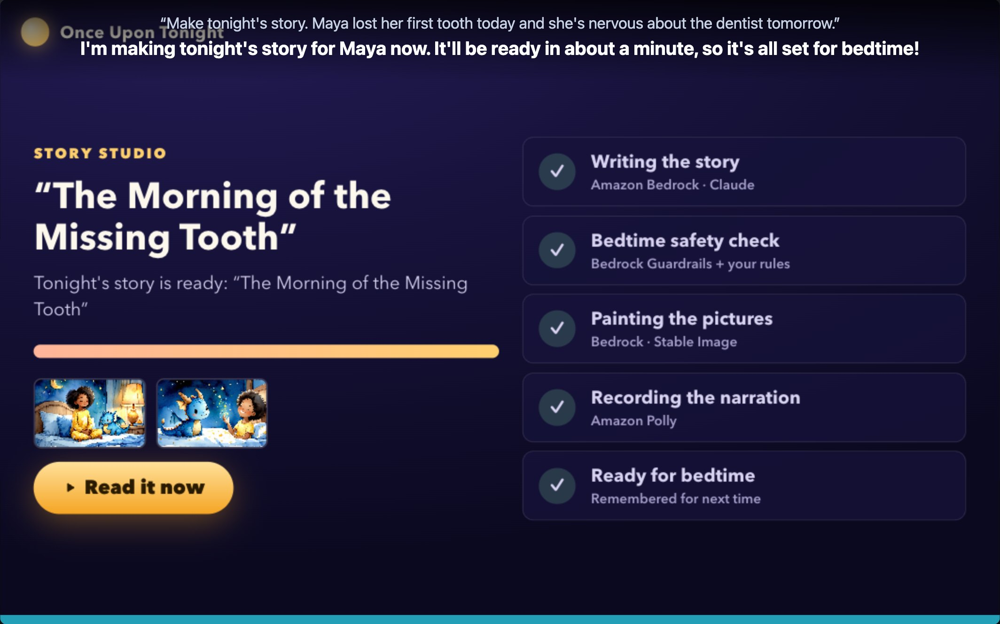
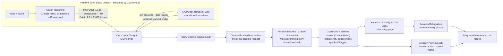

# 🌙 Once Upon Tonight

**An Alexa+ add-on (MCP server) that turns a child's day into tonight's bedtime story: written, illustrated, narrated with read-along highlighting, choose-your-path, and remembered night after night.**

> Built for the **Build, Ship, Shape: Amazon Developer Hackathon** · Alexa+ track · AWS Builder & Open Source mini challenges.
> 🎬 Demo video: https://youtu.be/Lgh42f-NPUk · ▶️ Try it in your browser: **https://d3eqnu2zudrdt1.cloudfront.net** · 🌐 Live demo endpoint: `https://d29fplx2av89ja.cloudfront.net/mcp` (demo mode, see [below](#try-the-hosted-demo)) · 🧪 Simulator: [**Countertop**](https://github.com/PRIEST099/countertop) (open source)



**TL;DR**
- A parent tells Alexa about the day.
- An agentic pipeline on AWS writes, safety-checks, paints and narrates an original picture book about it, in a couple of minutes.
- At bedtime the family reads it together on the Echo Show, with read-along highlighting and a choice of what happens next.
- The story world remembers, so tomorrow's story calls back to tonight's.

---

## Why

Bedtime is when kids bring up their day: the first swimming lesson, the wobbly tooth, the dentist tomorrow. Parents are tired, and the same three books get read again. Picture books are one of the best tools parents have for big feelings and new words, but no book on the shelf is about *their* day.

**Once Upon Tonight** lets a parent say:

> *"Alexa, make a short story for tonight. Maya had her first swimming lesson today. She was scared to put her face in the water, but she did it! Lesson two is tomorrow."*

A couple of minutes later there's an original picture book starring Maya and her sidekick Pip the baby dragon.
- It's painted page by page and narrated with **word-by-word read-along highlighting**, with each character's lines in their own voice.
- The family **chooses what happens next**.
- It ends on a calm wind-down page, then the screen dims for sleep.
- Tomorrow's story remembers tonight's. In our demo, the swimming story opens *"just like the night before the dentist"*, calling back to the previous night's episode.

## What it does

| | |
|---|---|
| ✍️ **Today → tonight's story** | The parent's own words become a gentle, original story at the child's reading level. Worries get a concrete coping idea (a slow breath, asking for help) and are never dismissed. |
| 🎨 **Illustrated every page** | A consistent watercolor style. Characters are described by appearance (never by name), so the same hero and sidekick show up on every page. Every picture is moderated by Amazon Rekognition before it's kept. |
| 🎙️ **Narrated read-along** | Amazon Polly narration with word timings. The current word lights up as it's read. |
| 🎭 **Character voices** | The narrator reads the story, and each character speaks in their own voice (Maya: Ivy, Pip: Kevin, grown-ups get adult voices). Quotes are found by code; Claude Haiku says who speaks each one. If a page doesn't line up, the narrator reads it. |
| 🧭 **Choose your path** | At the turning point, tap a picture or just say *"the pillow fort!"*, *"the second one"* or *"the other one"*. |
| ✨ **Word of the night** | One slightly-new word per story. Tap it, or ask what it means. |
| 🗺️ **A story world that remembers** | Sidekick, places, friends and past episodes carry over between nights. |
| 🔈 **Voice-only too** | On devices without a screen, `read_mode: "voice"` reads the story aloud in short chunks ("Shall I keep going?") up to the choice. |
| 🌙 **Sleep-friendly** | A dark UI, a slow last page, and the screen dims after "The End". |
| 👪 **Parent-run and private** | The parent links the account and sets the hero's nickname, age, reading level, favourites and *never-mention* topics. They get a morning recap, and deleting a child's stories and memories takes one request plus a confirmation. |
| 🛡️ **Safety, measured** | Every request and page is checked by Amazon Bedrock Guardrails (content filters + prompt-attack detection) and by a bedtime-suitability review (Claude Haiku on Bedrock, explicit rubric). Flagged drafts are rewritten gentler, never shown. On our labeled set: **184/184**, including 64 held-out cases ([eval](eval/safety/README.md); synthetic cases, one run). |
| 💰 **Cost-aware** | Each story records its estimated AWS cost and generation time (shown in the Studio). New paid stories are capped per family per day, and repeat requests are deduplicated. |

## How it uses Alexa+ and MCP

A **self-hosted MCP server** (spec **2025-11-25**, **Streamable HTTP**, stateless), built to the published **Alexa+ MCP add-on** requirements:

- **11 MCP tools:** 10 the assistant can call, plus 1 used only by the storybook view. Each tool covers one intent, with inputs designed for one-shot extraction from what was said:

  | Tool | Who | What |
  |---|---|---|
  | `create_tonights_story` | parent | start the story pipeline from today's moments, theme and length (deduplicated, capped) |
  | `check_story_progress` | anyone | "is the story ready?" |
  | `open_storybook` | family | open tonight's (or an earlier) story, resuming where reading stopped; `read_mode` screen/voice |
  | `turn_page` | family | next / previous / again / from the beginning |
  | `choose_path` | family | pick a branch from the listener's own words, or `option_number` |
  | `explain_word` | family | kid-friendly meaning of the word of the night |
  | `story_library` | family | the story shelf |
  | `bedtime_recap` | parent | what was heard, what was chosen, which words were explored |
  | `update_story_world` | parent | hero nickname/age/reading level, favourites, never-mention topics, recurring characters, sidekick |
  | `forget_story_world` | parent | delete stories and memories; the server requires a confirmation token |
  | `log_reading_progress` | app only | the storybook view records page and word taps (`visibility: ["app"]`) |

- **MCP Apps UI:**
  - `text/html;profile=mcp-app`, one self-contained bundle, content-hashed `ui://` URI, declared CSP domains.
  - It renders the Story Studio, the storybook, the library, the recap and the story world.
  - `_meta.ui.resourceUri` is on both the tool definition (the MCP Apps standard) and the tool result (Alexa+ style).
- **Three layers in every result:**
  - `content` is what Alexa says (in screen mode just a short cue, because the storybook narrates);
  - `structuredContent` holds compact facts Alexa can reason over and recall;
  - `_meta` carries the view payload, kept out of the model's context.
- **Built for unknown host capabilities:** the view gets the whole story at once, so page turns and choices still work if a host can't proxy UI tool calls. Calls from the view are best-effort, and there's a "tap to start" button if autoplay is blocked.
- **Inside the 500 ms budget:** on the hosted AWS demo (t4g.nano) tool calls take 2–14 ms server-side; locally 3–20 ms, under 100 ms in every test. The writing, painting and narrating (a couple of minutes) run in the background while the Studio polls progress.
- **Account linking built to the published Alexa+ requirements:**
  - OAuth 2.1 authorization code + **PKCE S256** + RFC 8707 `resource`.
  - **Protected Resource Metadata** at `/.well-known/oauth-protected-resource`, and Authorization Server Metadata.
  - Refresh-token rotation with reuse detection, and a **bare `401`** (no `WWW-Authenticate`).
  - A pre-registered Alexa client; Dynamic Client Registration for other hosts.
  - Hardening: Origin validation (403), hashed passwords and tokens, rate-limited sign-in, binding to localhost by default.
- **Add-on manifest template:** [`addon-package/addon.json`](addon-package/addon.json). Set your public host; icons and account-linking credentials are configured at deploy time.

> The Alexa+ add-on console, CLI and web simulator are partner-only right now (see the hackathon FAQ), so the demo runs in **[Countertop](https://github.com/PRIEST099/countertop)**, our open-source Echo Show simulator. It's a real MCP client that does account linking, voice, an LLM-driven agent loop and MCP Apps rendering. It also runs 17 checks derived from the published Alexa+ requirements, and Once Upon Tonight passes all 17. That's a self-assessment, not Amazon certification.

## Architecture



**AWS services (AWS Builder mini challenge):**

| Service | Used for | Where |
|---|---|---|
| **Amazon Bedrock**: Converse, Claude Sonnet 4.6 | Writes the branching story as structured JSON via a forced tool call | [`src/story/writer.ts`](src/story/writer.ts) |
| **Amazon Bedrock Guardrails**: `ApplyGuardrail` | Content filters, prompt-attack filter, profanity, checked per request and per page. Created by script. Active when `GUARDRAIL_ID` is set; the server warns at startup if it isn't. | [`src/story/safety.ts`](src/story/safety.ts), [`scripts/create-guardrail.ts`](scripts/create-guardrail.ts) |
| **Amazon Bedrock**: Converse, Claude Haiku 4.5 | Bedtime-suitability review against an explicit rubric. Chosen over Guardrails denied topics after measuring them on 120 dev cases, then verified on 64 held-out cases. | [`src/story/safety.ts`](src/story/safety.ts), [`eval/safety`](eval/safety/README.md) |
| **Amazon Bedrock**: InvokeModel, Stability SD3.5 Large (us-west-2) | One watercolor per page, painted one at a time with backoff (rate limits) | [`src/story/illustrator.ts`](src/story/illustrator.ts) |
| **Amazon Rekognition**: `DetectModerationLabels` | Moderates every illustration before it's kept (repaint, then fall back to the previous picture) | [`src/story/safety.ts`](src/story/safety.ts), [`src/story/pipeline.ts`](src/story/pipeline.ts) |
| **Amazon Polly**: neural `Danielle` + word speech marks | Narration and read-along timings (UTF-8 byte → character offset mapping); character lines in other neural voices, joined with timings shifted by each line's length | [`src/story/narrator.ts`](src/story/narrator.ts), [`src/story/voices.ts`](src/story/voices.ts) |
| **Amazon EC2 + Amazon CloudFront** | The hosted demo: a t4g.nano instance reachable only from CloudFront, with HTTPS at the edge. Managed via SSM, no SSH. | [`infra/deploy-aws.sh`](infra/deploy-aws.sh) |
| **Amazon Bedrock** (Claude Haiku 4.5) + **Amazon Polly** | The simulated Alexa+ brain and voice in Countertop | [countertop](https://github.com/PRIEST099/countertop) |

Each story stores an itemized cost estimate at list prices ([`src/story/cost.ts`](src/story/cost.ts)). A 6-page story is roughly **$0.65**, mostly the illustrations.

## Try the hosted demo

`https://d29fplx2av89ja.cloudfront.net/mcp` runs on AWS in **demo mode** (`AI_MODE=mock`):
- Anyone can link the demo family (**parent@example.com / bedtime**).
- Every reading tool works.
- "Make tonight's story" replays a bundled demo story instead of calling paid models.

**Easiest: open https://d3eqnu2zudrdt1.cloudfront.net.** That's a hosted copy of [Countertop](https://github.com/PRIEST099/countertop), already pointed at this endpoint. Press **Link add-on**, allow, then type or hold Space and say "Make tonight's story about her first swimming lesson", "Read my bedtime story" or "How did bedtime go last night?". The hosted Countertop has a shared daily usage limit to keep costs down.

You can also point your own Countertop at the endpoint (paste the URL, then **Link add-on**), or run its headless check:

```bash
cd countertop && npm run check -- https://d29fplx2av89ja.cloudfront.net/mcp
```

## Run it locally

**Requirements:** Node 20.19+ or 22.12+.

```bash
git clone https://github.com/PRIEST099/once-upon-tonight && cd once-upon-tonight
npm install
AI_MODE=mock npm start           # no AWS needed: http://localhost:8787/mcp (replays the bundled story)
```

**Live mode** (Amazon Bedrock, Rekognition and Polly). You need model access to Claude Sonnet 4.6 and Claude Haiku 4.5 (us-east-1) and to SD3.5 Large (us-west-2):

```bash
aws login                        # or any AWS credentials
npm run check-aws                # checks the writer, the reviewer, the guardrail, image, Rekognition and Polly (a few cents)
npm run create-guardrail         # prints GUARDRAIL_ID / VERSION for .env
cp .env.example .env             # then edit
npm start
```

**Talk to it like Alexa+ would** with [Countertop](https://github.com/PRIEST099/countertop). Countertop itself needs Bedrock (Claude Haiku 4.5) and Polly in us-east-1. Without AWS, use `REQUIRE_AUTH=false npm start` with MCP Inspector (`npx @modelcontextprotocol/inspector`) instead.

```bash
git clone https://github.com/PRIEST099/countertop && cd countertop && npm install && npm start
# open http://localhost:5310 → Link add-on (demo family: parent@example.com / bedtime) → hold Space and talk
```

**Tests**

```bash
npm run smoke                    # Alexa-style account linking + the whole bedtime flow, timed against the 500 ms budget
npx tsx scripts/regression.ts    # choice phrasing, Origin/case checks, cap, deletion mid-generation (mock server, REQUIRE_AUTH=false)
npm run eval:safety              # 184 labeled bedtime-safety cases (live Bedrock calls)
```

## Privacy and the Alexa+ policy

Alexa+ add-ons must not target children or collect their data, so Once Upon Tonight is **parent-operated** and family-shared:
- The parent links the account and sets the story hero's nickname, age, reading level, appearance, favourites and never-mention topics.
- Stored per story: the parent's description of the day, the generated text, pictures, narration, and reading progress.
- There are no child accounts and no voice recordings; add-ons receive text, not audio.
- `forget_story_world` deletes a child's stories, pictures, narration and story memories after a server-checked confirmation.
- Stories are generated with Amazon Bedrock, which doesn't use prompts or outputs to train models.
- The privacy and terms pages are at `/privacy` and `/terms`.

## Project layout

```
src/
  server.ts          Express: Streamable HTTP /mcp, OAuth endpoints, Origin checks, media
  mcp.ts             MCP server: 11 tools, MCP App resource, three-layer results, read modes
  auth.ts            OAuth 2.1 authorization server + resource-server guard (Alexa+ shaped)
  store.ts           JSON-file store (seeded demo family; hashed passwords and tokens)
  story/pipeline.ts  Background pipeline: guard → write → check → paint (+ Rekognition) ∥ narrate → remember
  story/*.ts         Bedrock writer, safety (Guardrails + review + Rekognition), illustrator, Polly narrator, cost
app/                 MCP App (vanilla TS → one self-contained HTML via Vite)
addon-package/       Alexa+ add-on manifest template (addon.json)
infra/               AWS demo deployment (EC2 + CloudFront) and teardown
eval/safety/         184 labeled bedtime-safety cases + results
scripts/             smoke + regression tests, AWS check, guardrail tools, seed export
seed/                Bundled demo story for AI_MODE=mock
docs/                Friction log, product feedback
```

## Built during the hackathon

Everything in this repository was written from scratch during the submission window (Oct 21–23, 2026). The demo data includes a "previous night" episode so the video can show memory across sessions. See [`docs/FRICTION_LOG.md`](docs/FRICTION_LOG.md) for what we ran into along the way.

## License

[MIT](LICENSE)
