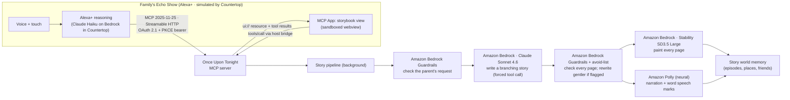

# 🌙 Once Upon Tonight

**An Alexa+ add-on (MCP server) that turns your child's day into tonight's bedtime story: written, illustrated, narrated with read-along highlighting, choose-your-path, and remembered night after night.**

> Built for the **Build, Ship, Shape: Amazon Developer Hackathon** · Alexa+ track · AWS Builder & Open Source mini challenges.
> Demo video: _(link)_ · Simulator used in the demo: [**Countertop**](https://github.com/PRIEST099/countertop) (open source)


---

## Why

Bedtime is when kids bring up their day: the wobbly tooth, the first day at school, the dentist tomorrow. Parents are tired, and the same three books get read again. Picture books are proven to help kids process big feelings and build vocabulary, but no book is about *their* day.

**Once Upon Tonight** lets a parent say:

> *"Alexa, make tonight's story. Maya lost her first tooth today and she's nervous about the dentist tomorrow."*

A minute later there's an original picture book starring Maya and her sidekick Pip the baby dragon. It's painted page by page, narrated with **word-by-word read-along highlighting**, and lets Maya **choose what happens next**. It ends on a calm wind-down page and the screen dims for sleep. Tomorrow's story remembers tonight's.

## What it does

| | |
|---|---|
| ✍️ **Today → tonight's story** | The parent's own words become a gentle, original story at the child's reading level. Worries get a concrete coping idea (a slow breath, asking for help) and are never dismissed. |
| 🎨 **Illustrated every page** | A consistent watercolor style. Characters are described by appearance so the same hero and sidekick show up on every page. |
| 🎙️ **Narrated read-along** | Amazon Polly narration with word timings. The current word lights up as it's read, which supports early literacy. |
| 🧭 **Choose your path** | At the story's turning point the child taps a picture or just says *"the pillow fort!"* |
| ✨ **Word of the night** | One slightly-new word per story. Tap it, or ask *"what does luminous mean?"* |
| 🗺️ **A story world that remembers** | Sidekick, places, friends and past episodes carry over, so the next story calls back to last night. |
| 🌙 **Sleep-friendly** | A dark UI, a slow wind-down last page, and the screen dims after "The End". |
| 👪 **Parent-run and private** | The parent links the account, sets a nickname, favourites and *never-mention* topics, gets a morning recap, and can say *"forget the story world"*. |
| 🛡️ **Safety by design** | An Amazon Bedrock Guardrail checks the parent's request and every page. Flagged drafts are rewritten gentler, never shown. |

## How it uses Alexa+ and MCP

Once Upon Tonight is a **self-hosted MCP server** (spec **2025-11-25**, **Streamable HTTP**, stateless) built to the published **Alexa+ MCP add-on** requirements:

- **11 voice-first tools**, one per intent. Inputs are designed for one-shot extraction from what the parent said:

  | Tool | Who | What |
  |---|---|---|
  | `create_tonights_story` | parent | start the agentic story pipeline from today's moments, theme and length |
  | `check_story_progress` | anyone | "is the story ready?" |
  | `open_storybook` | family | open tonight's (or an earlier) story; resumes where reading stopped |
  | `turn_page` | family | next / previous / again / from the beginning |
  | `choose_path` | child | pick a branch with the child's own words ("the castle!", "the first one") |
  | `explain_word` | child | kid-friendly meaning of the word of the night |
  | `story_library` | family | the story shelf (carousel) |
  | `bedtime_recap` | parent | what was heard, what was chosen, which words were explored |
  | `update_story_world` | parent | favourites, never-mention topics, recurring characters, sidekick name |
  | `forget_story_world` | parent | delete stories and memories (destructive; needs confirmation) |
  | `log_reading_progress` | app only | the storybook view records page and word taps (`visibility: ["app"]`) |

- **MCP Apps UI** (`text/html;profile=mcp-app`, one self-contained bundle with a content-hashed `ui://` URI and declared CSP domains). It renders the Story Studio, the storybook, the library, the recap and the story world. `_meta.ui.resourceUri` is on both the tool definition (MCP Apps standard) and the tool result (Alexa+ style).
- **Three layers in every result:** `content` is what Alexa says (voice-only friendly, under 30 s), `structuredContent` holds compact facts Alexa can reason over and recall, and `_meta` carries the full view payload, which is kept out of the model's context.
- **Built for unknowns:** the storybook gets the whole story at once, so page turns and choices still work if a host can't proxy UI tool calls. Every server call from the view is best-effort, and if autoplay is blocked a "tap to start" button appears.
- **Under 500 ms:** every tool call returns in **< 20 ms**. The minute of writing, painting and narrating runs in the background, and the Studio view polls progress.
- **Account linking exactly as Alexa+ expects:**
  - OAuth 2.1 authorization code + **PKCE S256** + RFC 8707 `resource`
  - **Protected Resource Metadata** at `/.well-known/oauth-protected-resource`
  - Authorization Server Metadata at `/.well-known/oauth-authorization-server`
  - refresh tokens with rotation, and a **bare `401`** (no `WWW-Authenticate`)
  - Dynamic Client Registration is also offered so other MCP hosts can link too.
- **Deploy-ready manifest:** [`addon-package/addon.json`](addon-package/addon.json) for `alexa-ai deploy`.

> The Alexa+ add-on console, CLI and web simulator are partner-only right now (see the hackathon FAQ), so the demo runs in **[Countertop](https://github.com/PRIEST099/countertop)**. That's our open-source Echo Show simulator: a real MCP client that does account linking, voice, an LLM-driven agent loop and MCP Apps rendering, and grades servers against the Alexa+ requirements (this one passes 17/17).

## Architecture



**AWS services (AWS Builder mini challenge):**

| Service | Used for | Where |
|---|---|---|
| **Amazon Bedrock**: Converse API, Claude Sonnet 4.6 | Writes the branching story as structured JSON via a forced tool call | [`src/story/writer.ts`](src/story/writer.ts) |
| **Amazon Bedrock Guardrails**: `ApplyGuardrail` | Content filters, denied topics (frightening content, unsafe activities), prompt-attack filter on parent input, profanity list. Created by script. | [`src/story/safety.ts`](src/story/safety.ts), [`scripts/create-guardrail.ts`](scripts/create-guardrail.ts) |
| **Amazon Bedrock**: InvokeModel, Stability SD3.5 Large (us-west-2) | One watercolor illustration per page, rate-limit aware | [`src/story/illustrator.ts`](src/story/illustrator.ts) |
| **Amazon Polly**: neural `Danielle` + word speech marks | Narration and read-along timings (byte→char offset mapping) | [`src/story/narrator.ts`](src/story/narrator.ts) |
| **Amazon Bedrock**: Claude Haiku 4.5 + **Amazon Polly** | The simulated Alexa+ brain and voice in Countertop | [countertop](https://github.com/PRIEST099/countertop) |

## Run it

**Requirements:** Node 20+. AWS credentials are optional, because mock mode replays the bundled demo story.

```bash
git clone https://github.com/PRIEST099/once-upon-tonight && cd once-upon-tonight
npm install
AI_MODE=mock npm start          # no AWS needed: http://localhost:8787/mcp
```

Live mode (Amazon Bedrock + Polly). You'll need model access to Claude Sonnet 4.6 (us-east-1) and SD3.5 Large (us-west-2):

```bash
aws login                        # or any AWS credentials
npm run check-aws                # verifies Bedrock text, image and Polly access
npm run create-guardrail         # optional: prints GUARDRAIL_ID / VERSION for .env
cp .env.example .env             # then edit
npm start
```

Talk to it like Alexa+ would with [Countertop](https://github.com/PRIEST099/countertop):

```bash
git clone https://github.com/PRIEST099/countertop && cd countertop && npm install && npm start
# open http://localhost:5310 → Link add-on (demo family: parent@example.com / bedtime) → hold Space and talk
```

**End-to-end test:** account linking + the full bedtime flow, with every call timed against Alexa+'s 500 ms budget:

```bash
npm run smoke                    # add -- --skip-create to reuse the latest story
```

Other MCP hosts work too. `REQUIRE_AUTH=false npm start`, then point MCP Inspector (`npx @modelcontextprotocol/inspector`) at `http://localhost:8787/mcp`. Hosts with MCP Apps support render the storybook.

## Privacy and the Alexa+ policy

Alexa+ add-ons must not target children or collect their data, so Once Upon Tonight is **parent-operated**:
- The parent links the account and sets a story-hero **nickname** and preferences.
- There are no child accounts and no voice recordings (Alexa never sends audio to add-ons).
- One sentence deletes everything (`forget_story_world`).
- Stories are generated with Amazon Bedrock, which doesn't use prompts or outputs to train models.
- Privacy and terms pages live at `/privacy` and `/terms`.

## Project layout

```
src/
  server.ts          Express: Streamable HTTP /mcp, OAuth endpoints, media, CORS
  mcp.ts             MCP server: 11 tools, MCP App resource, three-layer results
  auth.ts            OAuth 2.1 authorization server + resource-server guard (Alexa+ shaped)
  story/pipeline.ts  Background agentic pipeline: guard → write → check → paint ∥ narrate → remember
  story/*.ts         Bedrock writer, Guardrails, Stability illustrator, Polly narrator
  store.ts           JSON-file store (seeded demo family)
app/                 MCP App (vanilla TS → one self-contained HTML via Vite)
addon-package/       Alexa+ add-on manifest (addon.json)
scripts/             smoke test, AWS check, guardrail creation, seed export, prompt tools
seed/                Bundled demo story for AI_MODE=mock
docs/                Friction log, product feedback
```

## Built during the hackathon

Everything in this repository was written from scratch between Oct 21 and Oct 23, 2026. See [`docs/FRICTION_LOG.md`](docs/FRICTION_LOG.md) for what we ran into along the way.

## License

[MIT](LICENSE)
